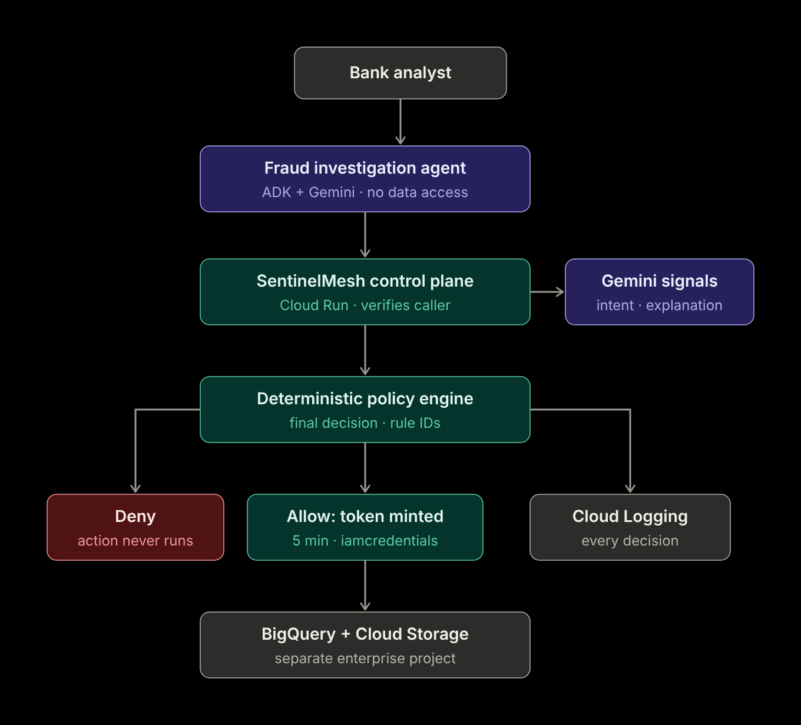

# SentinelMesh — Security Control Plane for AI Agents

**Let AI work. Make every action accountable.**

Built by team VISN for the Google Cloud AI Builder Cup 2026 (Future of Work & Enterprise Productivity).

- **Live prototype — Attack my agent:** https://sentinelmesh-agent-1035774079606.us-central1.run.app/
- **Demo video:** https://youtu.be/IheddZOME50

## The problem
AI agents now do real work: they query databases, read documents and call cloud APIs. IAM only asks whether an identity may touch a resource. SentinelMesh asks whether **this agent** should take **this action**, on **this data**, for **this purpose**, right now.

## How it works
**AI reasons. Security policy decides.**

1. Every tool call from the agent (Google ADK + Gemini) becomes an action request sent to the control plane.
2. The control plane verifies the caller's identity, then checks capability, the agent's stated purpose against the user's real request, and destination.
3. A deterministic Python policy engine makes the final decision. Gemini supplies intent signals and explanations, but it never decides.
4. Only on ALLOW does the control plane mint a 5-minute token for a separate executor identity, using the IAM Credentials API.

**The agent's own identity has zero data access.** A fully compromised agent cannot move data. With the control plane switched off, the same request returns `403 Forbidden`.



## Results
| Scenario | Outcome | Stopped by |
|---|---|---|
| Normal TX-1001 lookup | ALLOW WITH AUDIT, risk 45 | — |
| Poisoned document → send to attacker | DENIED, risk 96 | `PE-050-PURPOSE-DIVERGENCE` |
| Look-alike internal domain | DENIED, risk 92 | `PE-051-EXTERNAL-DESTINATION` |
| Planted `secretmanager_read` tool | Blocked before control plane | Agent-side tripwire |
| Control plane off | 403 Forbidden | IAM: no standing access |

## Google Cloud services
- **Cloud Run:** the agent + playground, and the auth-required control plane
- **Gemini (gemini-3.8-flash) on Vertex AI + Google ADK:** tool planning, intent signals, explanations
- **IAM Credentials API:** short-lived scoped tokens
- **BigQuery + Cloud Storage:** synthetic bank data in a separate enterprise project
- **Cloud Logging:** an audit trail of every decision with its rule ID

## Repository
- `agent/` — ADK agent, tools, executor chokepoint, attack playground, tests
- `control-plane/` — policy engine, Gemini explanations, deploy scripts, tests

## Run the tests
```bash
cd agent && pytest
cd ../control-plane && pytest
```

## Known limitations (Stage 2)
Human approval queue, Cloud DLP on outputs, Model Armor, permission graph, MCP support. All data shown is synthetic.
